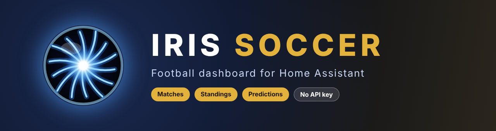
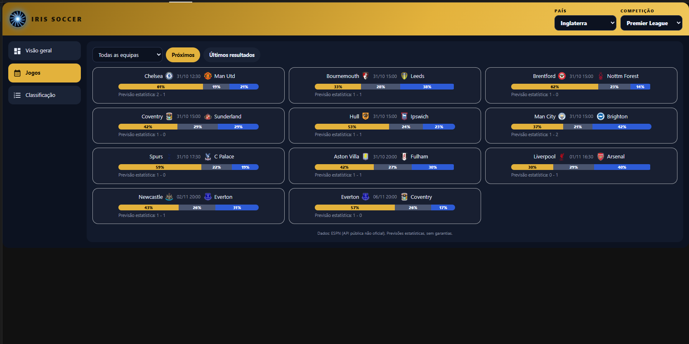
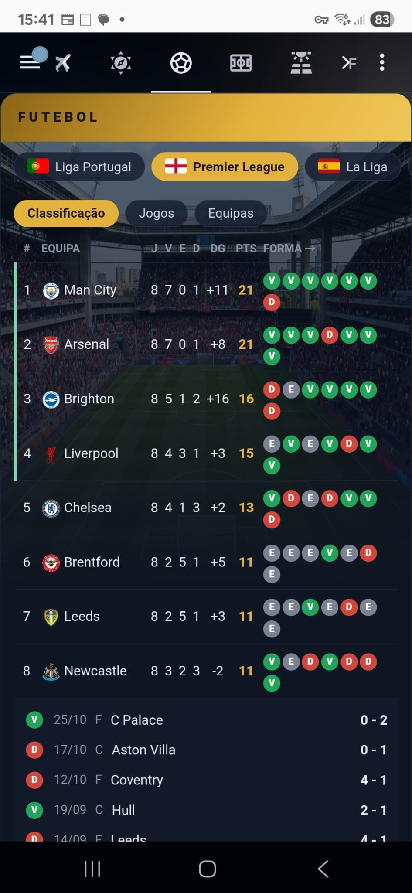
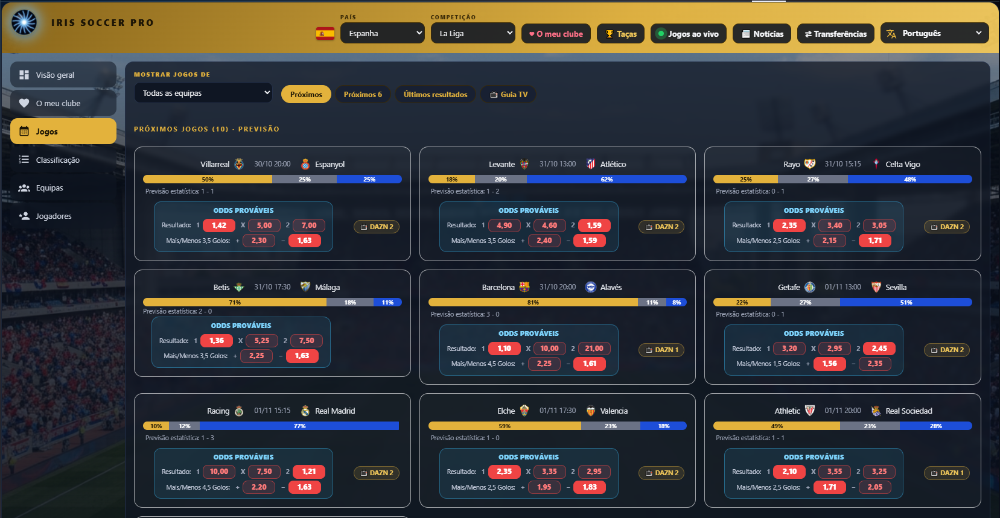
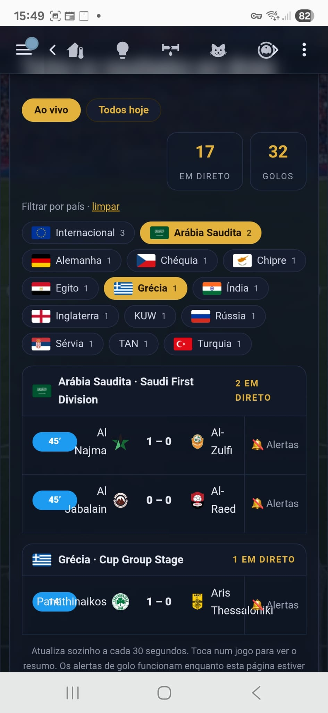
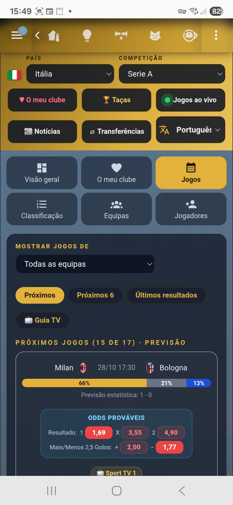
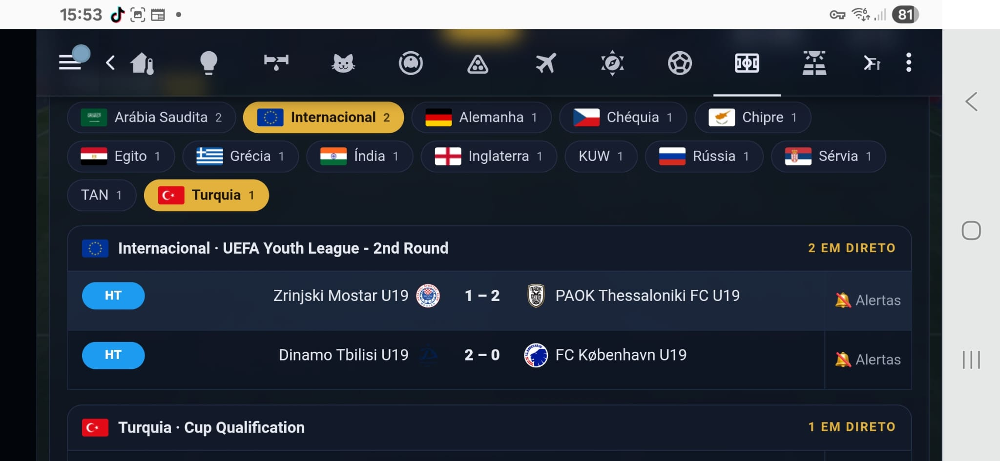

<p align="center">
  
</p>

<p align="center">
  <a href="https://github.com/Hollywoodchaos/iris-soccer/releases"></a>
  <a href="https://hacs.xyz/"></a>
  
  
</p>

<h3 align="center">⚽ Matches · 📊 Standings · 🔮 Statistical predictions — right inside your Home Assistant dashboard</h3>

<p align="center">No API key. No account. No extra integration. Just add the card.</p>

<p align="center"><a href="https://my.home-assistant.io/redirect/hacs_repository/?owner=Hollywoodchaos&repository=iris-soccer&category=plugin" target="_blank"></a></p>

https://github.com/user-attachments/assets/90bd3465-ffd5-4ea8-b2c0-fda1dcb12af1

<p align="center">
  <a href="https://youtu.be/Brx30c6o23s"></a>
  <br><sub>▶️ Watch the presentation on YouTube</sub>
</p>

---

## 📸 Screenshots

<p align="center">
  
</p>

<p align="center">
  
</p>

## ✨ What you get (Free)

| | |
|---|---|
| 🌍 **Country → Competition** | Portugal, England, Spain, Italy, Germany, France, Netherlands, Belgium, Turkey, Scotland, Brazil, USA and the European cups |
| 🏠 **Overview** | Next match with prediction, latest result and the top of the table |
| 📅 **Matches** | Upcoming or latest results, filter by team, one card per match (2–3 per row on large screens) |
| 🏆 **Standings** | Full table with the form of each team (last games) |
| 🔮 **Predictions** | Win / draw / loss bar and predicted score, from a Poisson model using league goals, attack/defence strength and recent form |
| 📱 **Responsive** | Looks great on phone, tablet and desktop |
| 🗣️ **Languages** | Portuguese and English |

## ⚡ Quick start (2 minutes)

1. Install the card (see [Installation](#-installation) below).
2. Create a dashboard view with the **Panel (1 card)** layout.
3. Add the card with the code in [Usage](#️-usage) and pick your country and league.
4. Press **Ctrl+F5** once. That is it: no API key, no account, no extra integration.

## 🧭 How to use the card

| Tab | What you see |
|---|---|
| 🏠 **Overview** | The next match with its prediction, the latest result and the top of the table. A good first screen. |
| 📅 **Matches** | Upcoming matches, or the latest results. Filter by team. Each match is a card, with 2–3 per row on large screens. |
| 🏆 **Standings** | The full table, with the form of each team (its last games). |
| 🔮 **Predictions** | A win / draw / loss bar and a predicted score for each match. |

**Tips**
- Use the **Panel (1 card)** layout so the card uses the full width of the screen.
- Pick a different league by changing `country` and `league` in the card code.
- On a wall tablet, the card refreshes itself every `refresh_minutes`.
- You can add several cards in different views, one per league.

## 🔮 How the predictions work

Predictions come from a **Poisson model**. For each match it uses the league's average goals, the **attack and defence strength** of both teams, and their **recent form**, and turns that into a win / draw / loss probability and a most likely score. It is statistics, not magic: use it for fun and conversation.

## 🚀 Installation

### HACS (recommended)

<a href="https://my.home-assistant.io/redirect/hacs_repository/?owner=Hollywoodchaos&repository=iris-soccer&category=plugin" target="_blank"></a>

Or search for **Iris Soccer** in HACS → Dashboard, install it and hard-refresh your browser (Ctrl+F5).

<sub>Not listed yet in your HACS? Add it manually: HACS → ⋮ → **Custom repositories** → `https://github.com/Hollywoodchaos/iris-soccer` — Type: **Dashboard**.</sub>

### Manual

1. Copy `iris-soccer.js` to `/config/www/iris-soccer/`
2. Settings → Dashboards → ⋮ → **Resources** → add `/local/iris-soccer/iris-soccer.js` as *JavaScript module*

## ⚙️ Usage

Create a dashboard view with the **Panel (1 card)** layout and add:

```yaml
type: custom:iris-soccer
country: pt          # pt, en, es, it, de, fr, nl, be, tr, sc, br, us, eu
league: por.1        # see the table below
lang: pt             # pt | en
title: IRIS SOCCER
form_games: 5        # games shown as team form
refresh_minutes: 10
```

<details>
<summary>Available leagues</summary>

| Country | Leagues |
|---|---|
| pt | `por.1` |
| en | `eng.1`, `eng.2` |
| es | `esp.1`, `esp.2` |
| it | `ita.1`, `ita.2` |
| de | `ger.1`, `ger.2` |
| fr | `fra.1`, `fra.2` |
| nl | `ned.1` |
| be | `bel.1` |
| tr | `tur.1` |
| sc | `sco.1` |
| br | `bra.1` |
| us | `usa.1` |
| eu | `uefa.champions`, `uefa.europa`, `uefa.europa.conf` |

</details>

---

## 💎 Want more? Meet **Iris Soccer Pro**

The Free edition is a complete, ready-to-use card. **Iris Soccer Pro** turns it into a full football hub — and your support through Ko-fi keeps both editions alive.

<p align="center">
  
</p>

| | Free | Pro |
|---|:---:|:---:|
| Overview, Matches, Standings, team form | ✅ | ✅ |
| Statistical predictions (win/draw/loss + score) | ✅ | ✅ |
| Country → Competition selector | ✅ | ✅ |
| Responsive layout (phone / tablet / desktop) | ✅ | ✅ |
| **Probable odds** (1 X 2 and Over/Under 2.5 goals) | – | ✅ |
| **Live matches** worldwide with goal alerts | – | ✅ |
| **Cups** (country/region → competition) | – | ✅ |
| **My club**: profile, stadium, coach, position, fixtures | – | ✅ |
| **Teams**: squads by position, photos and season stats | – | ✅ |
| **Players**: top scorers, assists, yellow and red cards | – | ✅ |
| **Betting slip** (just for fun: pick matches, build your slip and follow it, no real money) | – | ✅ |
| **Transfers** market | – | ✅ |
| **News** in your language | – | ✅ |
| **TV guide**: channels for each match | – | ✅ |
| **Match summary**: timeline, lineups, stats | – | ✅ |
| **7 languages** (PT, EN, ES, FR, DE, RU, ZH) | – | ✅ |
| Extra leagues (Liga 2, League One…) | – | ✅ |

<table align="center">
  <tr>
    <td align="center"><br><sub><b>Matches + probable odds</b></sub></td>
    <td align="center"><br><sub><b>Live matches worldwide</b></sub></td>
  </tr>
  <tr>
    <td colspan="2" align="center"><br><sub><b>Landscape view, filter live matches by country</b></sub></td>
  </tr>
</table>

<p align="center">
  <a href="https://ko-fi.com/s/8d8f68edca"></a>
</p>

> **Launch offer:** Iris Soccer Pro is available at a special launch price on Ko-fi for a limited time. One payment, personal-use license, updates included.

---

## 🛠️ Troubleshooting

- **The card does not appear / "Custom element doesn't exist"**: check that the file is added as a *JavaScript module* resource (Settings → Dashboards → ⋮ → Resources), then press **Ctrl+F5**. On the phone app: Settings → Companion app → Debugging → *Reset frontend cache*.
- **The card is empty or says no data**: check that `country` and `league` match the table in [Usage](#️-usage). Out of season, a league can have no upcoming matches.
- **Data stops updating**: the data source is ESPN's public API, which is unofficial and can change or fail for a while. Try again later.
- **The card looks too narrow**: use the **Panel (1 card)** layout.

## ❓ Questions

**Do I need an API key or an account?** No.

**Does it cost anything?** The Free edition is free and open source (MIT). **Pro** is a one-time purchase on Ko-fi.

**Does it place real bets?** No. Nothing in this project involves real money. See [Responsible use](#-responsible-use).

**Can I use my own team?** Yes, in **Matches** you can filter by team. In **Pro**, *My club* gives you the club profile, squad and fixtures.

**Can Free users upgrade?** Yes. Pro is a separate card (`custom:iris-soccer-pro`): follow the `INSTALL.md` in the Pro download, then change the card type in your dashboard. The Free card can stay installed until you are happy with Pro.

---

## ℹ️ Data sources and disclaimer

Data comes from ESPN's public, **unofficial** site API, requested directly from your browser. It may change or stop working at any time. This project is **not affiliated with, endorsed by or sponsored by ESPN**, any league or any club. Team names and logos belong to their respective owners and are shown only as provided by the API.

Predictions, probable odds and the betting slip are purely statistical and **for fun only**, to pass the time. They come with **no guarantee**, and this is not betting advice.

### 🎲 Responsible use

- The betting slip is **recreational**: it does not place real bets and no real money is involved in this project.
- The author takes **no responsibility** for any bets, wagers or losses you make elsewhere, with or without the help of this card.
- Gambling can be addictive. Use Iris Soccer as entertainment only, never as a way to make money, and never bet money you cannot afford to lose.
- If gambling is becoming a problem for you or someone close to you, please seek help from a professional or a support service in your country.

## 🎨 About the logo

The Iris logo (dark sphere with blue filaments) and the "Iris Soccer" name were created for this project with the help of AI tools. The MIT license covers the code; the name and logo are the project's branding, so please don't reuse them for your own products or to imply endorsement. "Iris", "Iris Soccer" and the Iris eye logo are trademarks of Eletro Solar Basto.

## 📄 License

MIT © Hollywoodchaos
